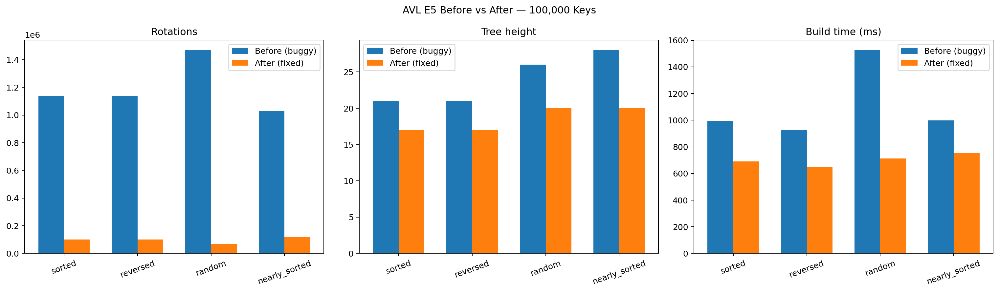

# INC-01: AVL Tree Incorrect Height Updates During Rotations


# INC-01: AVL Tree Incorrect Height Updates During Rotations

## Summary

The AVL tree had a performance bug caused by incorrect height updates during left and right rotations, resulting in excessive rotations, taller trees, and slower insertion times. In the E5 insertion-order experiment with 100,000 randomly inserted keys, build time decreased from 1,525.09 ms to 712.70 ms after the fix, a 53.3% improvement. The issue was resolved by updating the lower node's height before recalculating the new parent's height during rotations.

## Detection

The issue was identified through the E5 insertion-order sensitivity experiment, which tested sorted, reversed, random, and nearly sorted insertion orders at 1,000, 10,000, and 100,000 keys.

The performance comparison in `incident_reports/figures/INC-01-performance.png` showed that the original AVL implementation performed substantially more rotations, maintained taller trees, and required more time to build the index than the corrected implementation.

The unusually high rotation counts and tree heights suggested that the AVL tree was not maintaining its height and balance information correctly.

## Expected vs. observed

According to AVL tree theory, individual insertions should take O(log n) time because the tree maintains logarithmic height. Rotations should restore balance efficiently, and the stored height information should accurately reflect the tree structure.

However, the original implementation performed excessive rotations and produced taller trees than the corrected implementation.

For random insertion of 100,000 keys:

- Before fix: 1,468,392 rotations, tree height 26, and build time 1,525.09 ms.
- After fix: 70,011 rotations, tree height 20, and build time 712.70 ms.

This represents approximately 95% fewer rotations, a reduction in tree height from 26 to 20, and a 53.3% improvement in build time.

The same pattern appeared across all four insertion orders. These results indicate that the original implementation was performing unnecessary rebalancing because of incorrect height information.

## Evidence

The before-fix implementation came from commit `c2eab0a`. The temporary worktree rerun recorded `code_version=unknown`. The after-fix experiment recorded `code_version=b36e595`.

Both experiments were run on the same machine (`trisha-mbp`) using the E5 workload, deterministic seed, and five repetitions per configuration.

We tested four insertion orders (sorted, reversed, random, and nearly sorted) with 1,000, 10,000, and 100,000 keys.

### Performance Comparison (100,000 Keys)

| Insertion Order | Before Fix (ms) | After Fix (ms) | Improvement |
|---|---:|---:|---:|
| Sorted | 994.72 | 690.23 | 30.6% |
| Reversed | 925.49 | 648.96 | 29.9% |
| Random | 1525.09 | 712.70 | 53.3% |
| Nearly sorted | 998.90 | 753.73 | 24.5% |

### Structural Evidence

| Insertion Order | Rotations Before | Rotations After | Height Before | Height After |
|---|---:|---:|---:|---:|
| Sorted | 1,139,341 | 99,983 | 21 | 17 |
| Reversed | 1,139,341 | 99,983 | 21 | 17 |
| Random | 1,468,392 | 70,011 | 26 | 20 |
| Nearly sorted | 1,030,336 | 120,232 | 28 | 20 |

The corrected implementation consistently performed fewer rotations, produced shorter trees, and reduced insertion time.

For random insertion with 100,000 keys, runtime decreased by approximately 53%, while rotations decreased by approximately 95%.

### Performance Figure



**Figure 1. AVL Tree Performance Before and After Fix (E5, 100,000 Keys).** The corrected implementation reduced rotations, tree height, and build time across all four insertion orders. Random insertion showed the largest build-time improvement of 53.3%. Figure generated using `incident_reports/plot_avl.py`.

## Root cause

**File:** `indexes/avl_tree.py`

**Functions:** `_rotate_right()` and `_rotate_left()`

**Locations:** Around lines 59–66 and 77–84.

The original AVL tree implementation updated node heights in the wrong order after a rotation.

When a right rotation occurs, node `y` moves below node `x`. Therefore, the height of `y` should be recalculated before the height of `x`.

When a left rotation occurs, node `x` moves below node `y`. Therefore, the height of `x` should be recalculated before the height of `y`.

The original implementation did the opposite.

This meant the new parent could calculate its height using outdated height information from its child. Incorrect stored heights could then produce incorrect balance factors and trigger unnecessary rotations.

The tree could still return correct results because rotations preserved binary-search-tree key ordering. However, the unnecessary rebalancing increased runtime and caused the tree to become taller than expected.

## Fix

I corrected the order of height updates in both rotation functions.

**Fix commit:** `53e8911`

### Actual Git Diff

Generated using:

```bash
git diff c2eab0a 53e8911 -- indexes/avl_tree.py
```

```diff
diff --git a/indexes/avl_tree.py b/indexes/avl_tree.py
index bef0b73..c376556 100644
--- a/indexes/avl_tree.py
+++ b/indexes/avl_tree.py
@@ -59,8 +59,8 @@ class AVLTreeIndex(Index):
         y.left = x.right
         x.right = y
         # x and y swapped places; refresh their stored heights.
-        _update_height(x)
         _update_height(y)
+        _update_height(x)
         self.stats.rotations += 1
         return x

@@ -77,8 +77,8 @@ class AVLTreeIndex(Index):
         x.right = y.left
         y.left = x
         # x and y swapped places; refresh their stored heights.
-        _update_height(y)
         _update_height(x)
+        _update_height(y)
         self.stats.rotations += 1
         return y
```

The corrected implementation updates the lower node's height before updating the new parent.

The full diff is also saved in `incident_reports/INC-01-diff.txt`.

## Verification

To verify the fix, I reran the E5 insertion-order experiment using both the original buggy AVL implementation and the corrected implementation.

The original implementation was executed in a temporary Git worktree at commit `c2eab0a`, allowing me to preserve my current branch and existing results.

Both experiments used:

- E5 insertion-order sensitivity experiment
- 1,000, 10,000, and 100,000 keys
- Sorted, reversed, random, and nearly sorted insertion orders
- Five repetitions per configuration
- The same deterministic workload generation
- The same Mac (`trisha-mbp`)

The before-fix results were preserved in `incident_reports/evidence/INC-01-before.csv`, and the after-fix results are in `results/timings.csv`.

At 100,000 keys, all four insertion orders showed improvements in runtime, rotation count, and tree height.

### Regression Tests

I ran:

```bash
make test
```

Results:

```text
168 passed, 3 skipped in 4.00s
```

All existing tests continued to pass after the fix.

## Impact on recommendations

This bug made the AVL tree appear slower than it should have been, particularly for workloads involving many insertions.

Because the original implementation performed excessive rotations and maintained taller trees, its measured insertion costs were artificially high.

After correcting the bug, the AVL tree became significantly more efficient.

This strengthens the recommendation for AVL trees in features requiring ordered data, efficient point lookups, and frequent insertions.

However, the fix does not automatically make AVL trees the best choice for every feature.

For range-heavy workloads, B+ trees may still be preferable because their linked leaves support efficient range scans.

For exact-match-only workloads, hash tables may still be preferable because of their expected constant-time lookup performance.

Therefore, the bug could have caused us to underestimate AVL performance for insertion-heavy features. The final F1–F4 recommendations should use the corrected benchmark results rather than the original buggy measurements.

## Why the tests didn't catch it

The existing tests primarily checked functional correctness, such as whether inserted values could be retrieved correctly.

The height-update bug did not necessarily change the values returned by searches because the rotations still preserved binary-search-tree key ordering.

However, the tests did not sufficiently check internal height metadata or excessive rotations.

A stronger test would:

1. Insert keys using sorted, reversed, random, and nearly sorted orders.
2. Recursively calculate the actual height of every subtree.
3. Compare each calculated height with the node's stored height.
4. Verify that every node satisfies the AVL balance condition.
5. Monitor rotation counts and tree heights to detect unnecessary rebalancing.

These tests could detect incorrect height metadata even when searches returned the expected results.

This incident demonstrates why data structure testing should verify both functional correctness and internal structural invariants, rather than relying only on correct query results.

