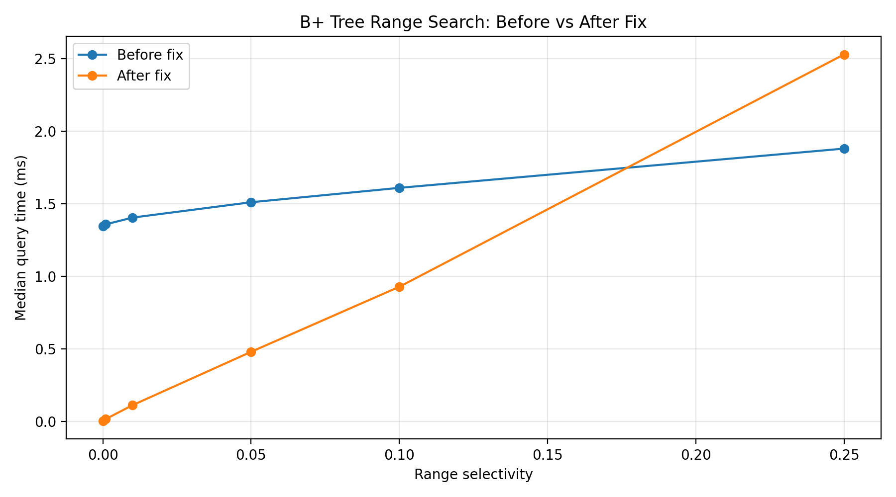

# INC-02: B+ Tree Inefficient Range Search

## Summary

The B+ tree had a performance issue where range searches recursively traversed the entire tree, even when the requested range contained very few matching keys. In the E3 range-query experiment, the original implementation took 1,345,678 ns per query at 0.0001 selectivity, compared with 3,556 ns after the fix, representing a 378.4x speedup. The issue was resolved by navigating directly to the starting leaf and scanning through linked leaves instead of traversing unrelated subtrees.

## Detection

The performance issue was identified through the E3 range-query experiment, which measured B+ tree query times across six selectivity levels: 0.0001, 0.001, 0.01, 0.05, 0.10, and 0.25.

The results, shown in `incident_reports/figures/INC-02-performance.png`, revealed that the original implementation took approximately 1.35–1.88 ms per query regardless of how narrow the requested range was.

This was suspicious because a B+ tree should efficiently locate the starting key and scan only the relevant portion of its linked leaves. The relatively high query times for very narrow ranges suggested unnecessary traversal.

## Expected vs. observed

According to B+ tree theory, a range search should take approximately O(log n + k) time, where n is the number of indexed keys and k is the number of matching keys, assuming a balanced tree and efficient sequential leaf scanning.

For narrow ranges, the algorithm should visit only the nodes along the search path and the leaf nodes containing matching keys, rather than traversing the entire tree.

However, the original implementation recursively visited every subtree regardless of the requested range, resulting in approximately O(n) traversal work.

At selectivity 0.0001, the original implementation required 1,345,678 ns per query, compared with 3,556 ns after the fix. At selectivity 0.01, query time decreased from 1,404,689 ns to 110,682 ns, representing a 12.7x speedup.

The optimized implementation also demonstrated more efficient node traversal. In a diagnostic test with 10,000 keys, a narrow query matching 11 keys visited only 5 nodes, while a full-range query matching 10,000 keys visited 628 nodes.

These results show that the corrected implementation scales its traversal work with the requested range rather than scanning unrelated subtrees.

## Evidence

The original B+ tree implementation performed range searches by recursively traversing the entire tree, even when the requested range contained very few matching keys. This resulted in unnecessary node visits and slower query performance.

We compared E3 range-query benchmark results using the original implementation (`dd70faa`) and the fixed implementation (`a0e890d`).

### Table 1: E3 Range Query Performance

| Selectivity | Before (ns/query) | After (ns/query) | Speedup |
|---|---:|---:|---:|
| 0.0001 | 1,345,678 | 3,556 | 378.4x |
| 0.001 | 1,358,345 | 15,406 | 88.2x |
| 0.01 | 1,404,689 | 110,682 | 12.7x |
| 0.05 | 1,510,550 | 478,924 | 3.2x |
| 0.10 | 1,609,786 | 927,447 | 1.7x |
| 0.25 | 1,880,570 | 2,530,060 | 0.74x |

The optimized implementation was significantly faster for narrow ranges. At selectivity 0.0001, query time decreased by approximately 99.7%.

However, at selectivity 0.25, the fixed implementation was approximately 34.5% slower, indicating that the optimization is most beneficial for selective range queries.

### Figure 1: B+ Tree Range Query Performance



**Figure 1. B+ Tree Range Query Performance Before and After Fix (E3).** The optimized implementation significantly reduced median query time for narrow ranges, achieving a 378.4x speedup at 0.0001 selectivity. However, at 0.25 selectivity, the fixed implementation was approximately 34.5% slower. Figure generated using `incident_reports/plot_bplus.py`.

### Table 2: B+ Tree Diagnostic Results

We inserted 10,000 sequential integer keys into a B+ tree with order 32.

The resulting tree had:

- Height: 4
- Distinct keys: 10,000
- Leaves: 625
- Average leaf fill: 0.516

| Query range | Matching keys | Nodes visited | Comparisons |
|---|---:|---:|---:|
| 5000–5010 | 11 | 5 | 26 |
| 5000–6000 | 1,001 | 67 | 1,016 |
| 0–9999 | 10,000 | 628 | 10,016 |

These diagnostic results were collected before correcting a duplicate starting-leaf counter increment. The final implementation avoids double-counting the starting leaf.

The diagnostic shows that narrow range queries visit significantly fewer nodes than wide range queries.

## Root cause

**File:** `indexes/bplus_tree.py`

**Functions:** `range_search()` and `_collect_range()`

**Original lines:** 173–189

The original `range_search()` method called `_collect_range()` starting from the root of the B+ tree.

The `_collect_range()` function recursively visited every child of every internal node, regardless of whether the subtree contained keys within the requested range.

Original code:

```python
def range_search(self, lo: Any, hi: Any) -> list[Any]:
    result: list[Any] = []
    if lo <= hi:
        self._collect_range(self._root, lo, hi, result)
    return result
```

The unnecessary traversal occurred in:

```python
for child in node.children:
    self._collect_range(child, lo, hi, out)
```

For example, when searching for keys between 5000 and 5010 in a tree containing 10,000 keys, the implementation still traversed the entire tree.

The B+ tree already maintained sorted keys and linked leaves, but the original implementation did not take advantage of these features.

The bug did not affect correctness because the implementation checked whether each key fell within the requested range before adding its values to the result.

However, it increased the amount of work required for range searches, especially narrow ones.

## Fix

**File:** `indexes/bplus_tree.py`

**Commit:** `a0e890d`

**Commit message:** Optimize B+ tree range search using linked leaves

We replaced the recursive full-tree traversal with an optimized range search that uses the B+ tree's linked leaves.

The updated implementation:

1. Uses `_find_leaf(lo)` to navigate directly to the leaf containing the lower bound.
2. Uses `_bisect_left()` to find the first relevant key.
3. Collects matching values.
4. Follows the `next` pointers between leaves.
5. Stops when a key exceeds the upper bound.

Updated code:

```python
def range_search(self, lo: Any, hi: Any) -> list[Any]:
    result: list[Any] = []

    if lo > hi:
        return result

    leaf = self._find_leaf(lo)
    i = self._bisect_left(leaf.keys, lo)

    while leaf is not None:
        while i < len(leaf.keys):
            self.stats.comparisons += 1

            if leaf.keys[i] > hi:
                return result

            result.extend(leaf.values[i])
            i += 1

        leaf = leaf.next
        i = 0

        if leaf is not None:
            self.stats.nodes_visited += 1

    return result
```

This change avoids traversing unrelated subtrees.

The expected time complexity improves from O(n) for a full-tree traversal toward O(log n + k), where k represents the number of matching keys, with additional leaf traversal and output costs.

The fix preserves correct range-search results while reducing unnecessary operations.

### Git Diff

The following diff shows the changes made to optimize the B+ tree range search.

```diff
diff --git a/indexes/bplus_tree.py b/indexes/bplus_tree.py
index 7005649..75654d6 100644
--- a/indexes/bplus_tree.py
+++ b/indexes/bplus_tree.py
@@ -172,8 +172,28 @@ class BPlusTreeIndex(Index):
     def range_search(self, lo: Any, hi: Any) -> list[Any]:
         result: list[Any] = []
-        if lo <= hi:
-            self._collect_range(self._root, lo, hi, result)
+
+        if lo > hi:
+            return result
+
+        leaf = self._find_leaf(lo)
+        i = self._bisect_left(leaf.keys, lo)
+
+        while leaf is not None:
+            while i < len(leaf.keys):
+                self.stats.comparisons += 1
+
+                if leaf.keys[i] > hi:
+                    return result
+
+                result.extend(leaf.values[i])
+                i += 1
+
+            leaf = leaf.next
+            i = 0
+
+            if leaf is not None:
+                self.stats.nodes_visited += 1
         return result

     def _collect_range(self, node: _Node, lo: Any, hi: Any, out: list[Any]) -> None:
```

## Verification

After implementing the fix, we ran the correctness test suite using:

```bash
make test
```

**Result: 168 passed, 3 skipped.**

We also reran the E3 range-query experiment using the fixed implementation and compared its results against the original version.

- Original `code_version`: `dd70faa`
- Fixed `code_version`: `a0e890d`
- Original benchmark: 6 recorded repetitions per selectivity
- Fixed benchmark: 5 recorded repetitions per selectivity

Both versions used the E3 experiment definition and Spotify tempo dataset. The comparison should be interpreted with the assumption that the benchmark seeds and machine conditions were comparable.

The results demonstrated substantial performance improvements for narrow range queries:

- Selectivity 0.0001: 378.4x faster
- Selectivity 0.001: 88.2x faster
- Selectivity 0.01: 12.7x faster
- Selectivity 0.05: 3.2x faster
- Selectivity 0.10: 1.7x faster

At selectivity 0.25, the fixed implementation was approximately 34.5% slower.

The diagnostic results also demonstrated that the optimized B+ tree visits fewer nodes for narrower ranges.

Overall, the fix preserved correctness and significantly improved selective range-query performance.

## Impact on recommendations

This bug primarily affects **F3: Workout Mode**, which requires finding songs within a specified tempo range.

The original B+ tree implementation made range searches appear inefficient because it traversed the entire tree regardless of the requested range.

This could have led us to incorrectly recommend against using a B+ tree for tempo-based searches.

After the fix, the B+ tree became much more efficient for narrow range queries because it could navigate directly to the relevant leaf and scan only the necessary portion of the index.

The E3 results showed a speedup of approximately 378 times at the lowest selectivity.

This makes the B+ tree a stronger candidate for F3, particularly when users request narrow tempo ranges.

However, the performance advantage decreases for broader ranges. At selectivity 0.25, the optimized implementation was slower than the original.

Therefore, the final recommendation for F3 should consider expected range selectivity and compare the fixed B+ tree against other index implementations.

The fix does not directly change F1 point lookups, F2 prefix searches, or F4 insertion performance.

## Why the tests didn't catch it

The existing tests focused on whether range searches returned correct results rather than whether they performed operations efficiently.

The original implementation passed correctness tests because it returned the correct matching values, even though it unnecessarily traversed the entire tree.

The tests did not check the number of nodes visited or comparisons performed.

A performance-focused test could detect this bug by building a large B+ tree and performing a narrow range query.

The test could then verify that `nodes_visited` is substantially smaller than the total number of nodes in the tree.

Another useful test would compare node visits for narrow and wide range queries. An efficient B+ tree should visit significantly fewer nodes for narrow ranges.

These tests would detect unnecessary traversal even when all returned results are correct.
